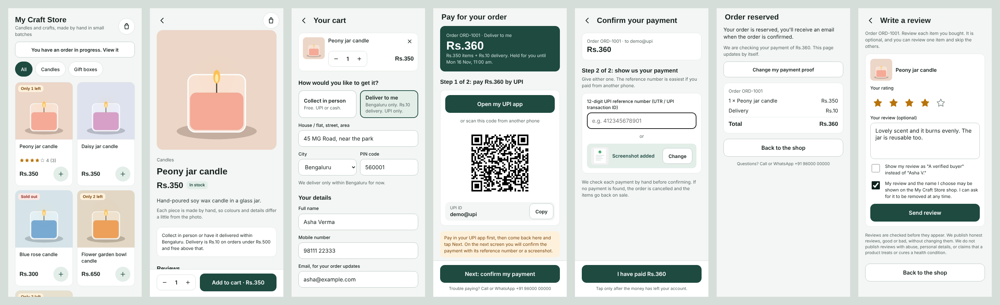
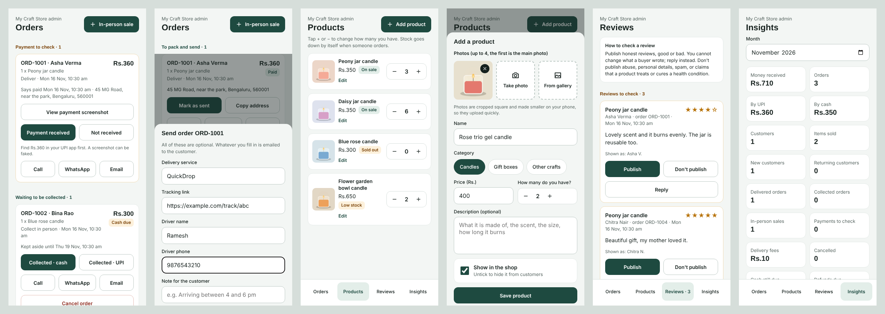

# Store App Prototype

A free, phone-first online shop for a small maker of handmade goods (candles, crafts, gifts). It runs entirely on a free Google account: Google Sheets for data, Apps Script for the app, Google Drive for product photos and payment screenshots, and Gmail for emails. There's no payment gateway, no monthly fee and no server to manage. Customers pay by UPI or cash, and the owner confirms each payment.




## What it does

**For customers (phone browser, no app to install)**
- Browse products by category, with "Only N left" and "Sold out" tags and up to 4 photos per product.
- Cart and checkout: collect in person (UPI or cash) or delivery within one city (UPI only, no cash on delivery). The city and PIN code are checked, and delivery is free above a set order value.
- A required consent tick box with a privacy notice.
- Pay by UPI in two steps: an "Open my UPI app" button, a QR code and the UPI ID first; then the 12-digit UPI reference number **or** a payment screenshot. "I have paid" stays disabled until proof is given.
- Items are reserved while the customer pays and while the payment is checked. Unpaid holds and uncollected cash orders are released automatically.
- An order page that updates by itself, with delivery details (courier, tracking link, driver) once the order is sent.
- Buyer-only reviews: after an order is delivered or collected, the customer is invited to rate each item (1–5 stars, optional text, consent tick, option to appear as "A verified buyer").

**For the owner (PIN-protected page, can be added to the phone's home screen)**
- **Orders**, grouped by what needs doing: payments to check (with the reference number and screenshot), refunds to make, to pack and send, waiting to be collected, on the way.
- **Payment received / Not received**, **Mark as sent** with optional courier, tracking link, driver name and phone, **Collected · cash / UPI** (with an on-screen QR), cancel with a reason, and an **in-person sale** button that keeps stock right.
- **Products:** add or edit from the phone camera or gallery (photos are cropped and shrunk on the phone), price, category, description, show or hide, and + / − stock.
- **Reviews:** nothing appears in the shop until the owner publishes it. Publish, don't publish (with a reason), reply, or take down. Published reviews can't be edited; the shop shows an average only once a product has 3 published reviews.
- **Insights by month:** money received (UPI / cash), orders, customers (new / returning), items sold, delivered / collected / in-person orders, delivery fees, cancellations, cash and refunds due, reviews, best sellers and low stock. The same figures appear on a Dashboard tab in the Sheet, with a month picker.
- Email alerts for payments to check, reviews to check and problems.

**Settings** (a tab in the Sheet, no code changes needed): store name, contact details, pickup address, UPI ID, delivery fee and free-delivery threshold, delivery cities and PIN prefixes, hold times, screenshot retention, categories, review settings, and the consent and privacy text.

## Install

See [docs/INSTALL.md](docs/INSTALL.md). In short: create a Google Sheet, paste `dist/Code.gs` and `dist/appsscript.json` into **Extensions ▸ Apps Script**, run `setup`, then deploy as a web app.

## Project layout

```
dist/         single-file build to paste into Apps Script (Code.gs + appsscript.json)
src/          the same app as separate files: server code, shop page, admin page, shared script and styles
build.js      bundles src/ into dist/Code.gs
test/         order flows against stand-ins for Google services, and a phone-width browser test
docs/         install guide
screenshots/
```

## Working on it

Needs Node.js 18 or later.

```
npm install
npm test                    # build + 169 flow checks
npx playwright install chromium
npm run test:ui             # build + 44 browser checks, screenshots in test/shots/
```

## Design choices
- **Payment proof without a gateway:** the customer gives a UPI reference number or a screenshot; the owner checks the money in their UPI app before confirming. A reused reference number is flagged.
- **Stock is reserved early** (when the order is placed) so two people can't pay for the last piece.
- **Data kept and deleted:** the Sheet is never deleted from. Payment screenshots live in their own private Drive folder, and only that folder is cleaned after a set number of days (default 90).
- **Reviews follow published review norms:** buyers only, checked before publishing, never edited, negative reviews published, and no health or cure claims.

## Limits of the free setup
- **Email cap:** a free Gmail account can send to about 100 recipients a day from scripts.
- **Banner:** Google shows a small "created by a Google Apps Script user" banner on the pages.
- **Photos** are served from Google Drive, which works but is not an officially supported way to host images.
- **Payments** are confirmed by hand; there's no automatic UPI matching.

## Privacy
No personal data lives in this code. Customer details, settings, the admin PIN and the UPI ID are stored only in the installer's own Google Sheet and Drive. The default privacy notice is a placeholder; replace it with text reviewed by a lawyer for your country (for India, the DPDP Act).
